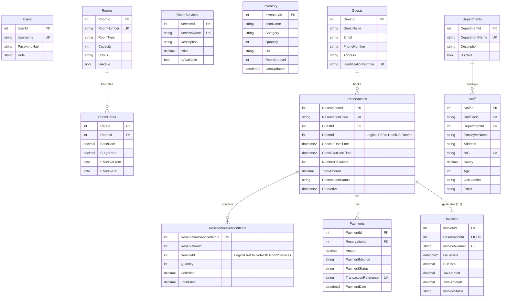

# Online Hotel Management System (HMS) - Microservices Platform

[](https://dotnet.microsoft.com/)
[]()
[]()
[]()
[-brightgreen.svg)]()

---

## 1. Solution Structure and Architecture

The solution adheres strictly to microservices design patterns, clean separation of concerns, and the architectural conventions defined in the Hotel Management System Low-Level Design (LLD v1.1).

```
HotelManagementSystem/
├── HotelManagementSystem.sln             # Master Solution file
├── global.json                           # SDK Pinning (10.0.403)
├── README.md                             # Solution Documentation & User Guide
│
├── HotelMS.Gateway/                      # API Gateway (YARP Reverse Proxy, Port 7000)
│   ├── Properties/launchSettings.json
│   ├── appsettings.json
│   ├── appsettings.Development.json
│   ├── Program.cs
│   └── HotelMS.Gateway.csproj
│
├── HotelMS.Auth/                         # Authentication Service (Port 7001, AuthDB)
│   ├── Controllers/UsersController.cs
│   ├── Data/AuthDbContext.cs, Configurations/, DbInitializer.cs
│   ├── DTOs/AuthDtos.cs
│   ├── Exceptions/AuthExceptions.cs, ExceptionHandlingMiddleware.cs
│   ├── Migrations/MigrationsMarker.cs
│   ├── Models/User.cs, Enums/UserRole.cs
│   ├── Repositories/Interfaces/, Classes/
│   ├── Services/Interfaces/, Classes/
│   ├── Validators/AuthValidators.cs
│   ├── Properties/launchSettings.json, appsettings*.json, Program.cs
│   └── HotelMS.Auth.csproj
│
├── HotelMS.HotelManagement/              # Hotel Management Service (Port 7002, HotelDB)
│   ├── Controllers/RoomsController.cs, RatesController.cs, RoomServicesController.cs, InventoryController.cs
│   ├── Data/HotelDbContext.cs, Configurations/, DbInitializer.cs
│   ├── DTOs/HotelDtos.cs
│   ├── Exceptions/HotelExceptions.cs, ExceptionHandlingMiddleware.cs
│   ├── Migrations/MigrationsMarker.cs
│   ├── Models/HotelEntities.cs, Enums/HotelEnums.cs
│   ├── Repositories/Interfaces/, Classes/
│   ├── Services/Interfaces/, Classes/
│   ├── Validators/HotelValidators.cs
│   ├── Properties/launchSettings.json, appsettings*.json, Program.cs
│   └── HotelMS.HotelManagement.csproj
│
├── HotelMS.Reservations/                 # Reservation Service (Port 7003, ReservationDB)
│   ├── BackgroundServices/PendingReservationExpiryService.cs
│   ├── Clients/IHotelClient.cs, HotelClient.cs (Typed HttpClient)
│   ├── Controllers/GuestsController.cs, ReservationsController.cs, PaymentsController.cs, InvoicesController.cs
│   ├── Data/ReservationDbContext.cs, Configurations/, DbInitializer.cs
│   ├── DTOs/ReservationDtos.cs
│   ├── Exceptions/ReservationExceptions.cs, ExceptionHandlingMiddleware.cs
│   ├── Helpers/IEmailHelper.cs, EmailHelper.cs (MailKit / SMTP)
│   ├── Migrations/MigrationsMarker.cs
│   ├── Models/ReservationEntities.cs, Enums/ReservationEnums.cs
│   ├── Repositories/Interfaces/, Classes/
│   ├── Services/Interfaces/, Classes/
│   ├── Validators/ReservationValidators.cs
│   ├── Properties/launchSettings.json, appsettings*.json, Program.cs
│   └── HotelMS.Reservations.csproj
│
├── HotelMS.Operations/                   # Hotel Operations Service (Port 7004, OperationsDB)
│   ├── Clients/IReservationClient.cs, ReservationClient.cs
│   ├── Controllers/DepartmentsController.cs, StaffController.cs, ReportsController.cs
│   ├── Data/OperationsDbContext.cs, Configurations/, DbInitializer.cs
│   ├── DTOs/OperationsDtos.cs
│   ├── Exceptions/OperationsExceptions.cs, ExceptionHandlingMiddleware.cs
│   ├── Migrations/MigrationsMarker.cs
│   ├── Models/OperationsEntities.cs
│   ├── Repositories/Interfaces/, Classes/
│   ├── Services/Interfaces/, Classes/
│   ├── Validators/OperationsValidators.cs
│   ├── Properties/launchSettings.json, appsettings*.json, Program.cs
│   └── HotelMS.Operations.csproj
│
└── Tests/                                # Test Projects (NUnit + Moq + FluentAssertions)
    ├── HotelMS.Auth.Tests/
    ├── HotelMS.HotelManagement.Tests/
    ├── HotelMS.Reservations.Tests/
    └── HotelMS.Operations.Tests/
```

### Architectural Layering Per Service
Each microservice enforces a unidirectional dependency hierarchy:
$$\text{Controller} \longrightarrow \text{Service Layer} \longrightarrow \text{Repository Layer} \longrightarrow \text{DbContext}$$
- **Controllers**: Expose RESTful endpoints, validate authorization roles, and map incoming HTTP requests to responses.
- **DTOs**: Ensure domain entities are never directly leaked outside the service boundary.
- **FluentValidation**: Validates inputs declaratively before executing service business logic.
- **Services**: Enforce domain invariants, business logic, calculations, and cross-service client interactions.
- **Repositories**: Encapsulate EF Core data access with explicit interfaces.
- **ExceptionHandlingMiddleware**: Catches domain exceptions and formats standardized JSON error payloads (`{ statusCode, message, traceId }`).

---

## 2. Microservice Database Schemas (12 Tables, 4 Databases)

All foreign keys enforce `DeleteBehavior.Restrict`. Enums are persisted as strings with check constraints. `SYSUTCDATETIME()` is used for timestamp defaults.



---

## 3. Microservices Ports & Gateway Routing

| Service Name | Port | Description |
| :--- | :--- | :--- |
| **HotelMS.Gateway** | `7000` | YARP Reverse Proxy & central API entry point |
| **HotelMS.Auth** | `7001` | User registration, authentication, JWT token issuance |
| **HotelMS.HotelManagement** | `7002` | Room inventory, dynamic surge pricing, catalog, inventory |
| **HotelMS.Reservations** | `7003` | Booking engine, payment processing, tax invoice (12%), expiry service |
| **HotelMS.Operations** | `7004` | Department management, staff allocation, salary & income reports |

### YARP Gateway Routing Rules
The API Gateway forwards requests based on prefix path routes:
- `/api/users/**` $\longrightarrow$ `https://localhost:7001`
- `/api/rooms/**`, `/api/rates/**`, `/api/roomservices/**`, `/api/inventory/**` $\longrightarrow$ `https://localhost:7002`
- `/api/guests/**`, `/api/reservations/**`, `/api/payments/**`, `/api/invoices/**` $\longrightarrow$ `https://localhost:7003`
- `/api/departments/**`, `/api/staff/**`, `/api/reports/**` $\longrightarrow$ `https://localhost:7004`

---

## 4. Key Business Logic Rules

1. **Surge Pricing & Nightly Rate Resolution**:
   - For every night of a reservation, `HotelMS.Reservations` queries `HotelMS.HotelManagement` for the effective rate on that date.
   - Effective rate equals $\text{BaseRate} + \text{SurgeRate}$ matching the date interval `EffectiveFrom <= Date <= (EffectiveTo ?? Date)`. If multiple rows match, the latest `EffectiveFrom` takes priority.
2. **Preventing Double Bookings & Same-Day Turnover**:
   - Two bookings overlap if and only if:
     $$\text{CheckIn}_{\text{new}} < \text{CheckOut}_{\text{existing}} \quad \text{AND} \quad \text{CheckOut}_{\text{new}} > \text{CheckIn}_{\text{existing}}$$
   - Hotel checkout is at 11:00 AM and checkin is at 2:00 PM. Same-day turnover bookings do **not** overlap.
3. **Pending Reservation Expiry**:
   - `PendingReservationExpiryService` runs in the background of `HotelMS.Reservations`. Reservations in `PendingPayment` status older than 30 minutes are automatically transitioned to `Cancelled`.
4. **Tax Invoicing**:
   - Invoices calculate a strict 12% tax:
     $$\text{SubTotal} = \text{Reservation Total}, \quad \text{TaxAmount} = \text{Round}(\text{SubTotal} \times 0.12, 2), \quad \text{Total} = \text{SubTotal} + \text{TaxAmount}$$
5. **Department Deletion Protection**:
   - Attempting to delete a department with active staff members throws a `ConflictException` (HTTP 409).

---

## 5. Running the System & Tests

### Prerequisites
- .NET 10 SDK (pinned in `global.json` as `10.0.403`)
- SQL Server (or LocalDB / In-Memory option enabled by default in `appsettings.json`)

### Executing All Tests
```bash
dotnet test HotelManagementSystem.sln
```
All unit tests across all 4 test projects run with 100% pass rate.

### Running the API Gateway and Microservices
Each project can be launched in development mode:
```bash
# Terminal 1: Auth Service
dotnet run --project HotelMS.Auth

# Terminal 2: Hotel Management Service
dotnet run --project HotelMS.HotelManagement

# Terminal 3: Reservation Service
dotnet run --project HotelMS.Reservations

# Terminal 4: Operations Service
dotnet run --project HotelMS.Operations

# Terminal 5: API Gateway
dotnet run --project HotelMS.Gateway
```
Navigate to `https://localhost:7000/swagger` to inspect and test all endpoints via Swagger UI.
